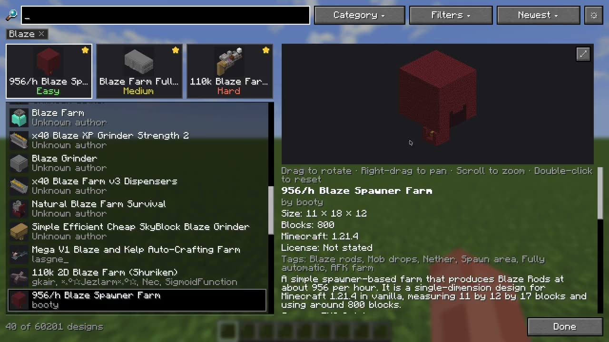
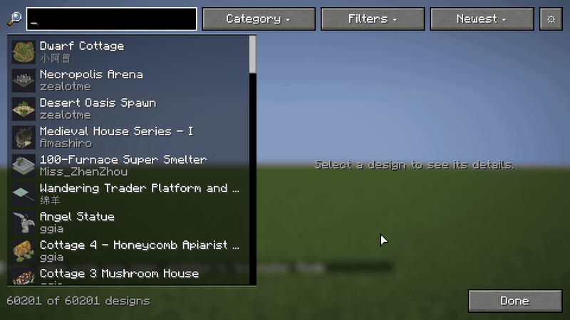
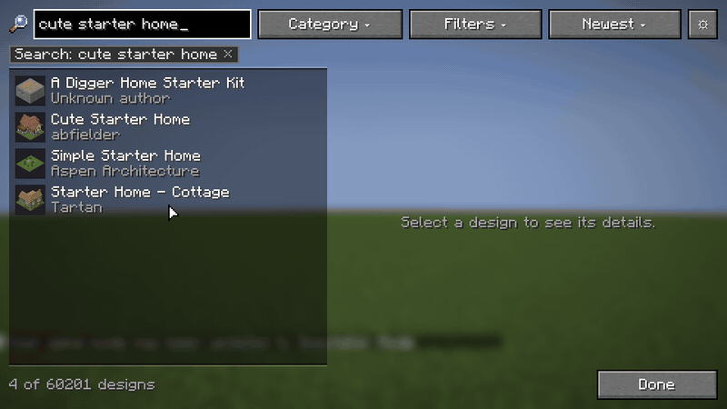
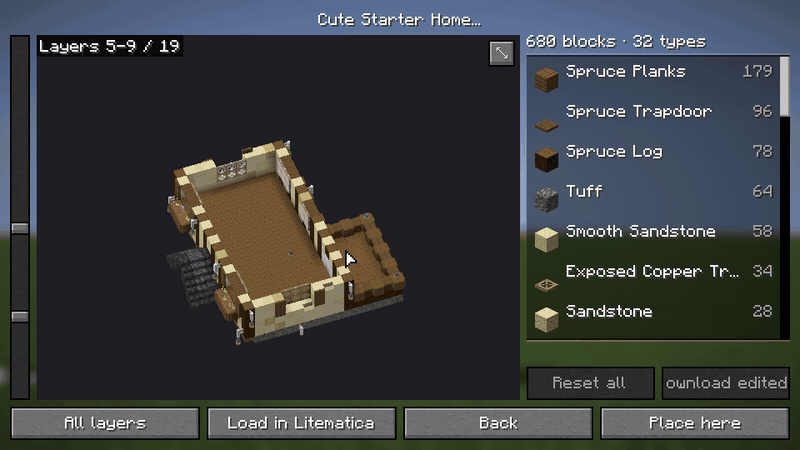
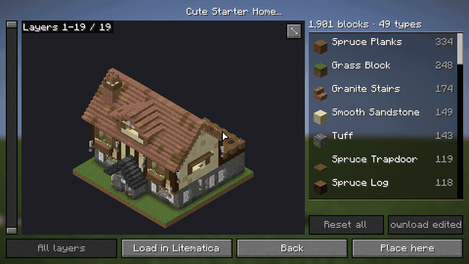
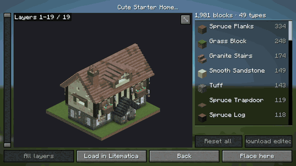

# Schematic Vault

Thousands of community designs (farms, storage systems, autocrafters, builds) browsable right in
game, and one click to save any of them into your schematics folder, ready to load in Litematica.

No more hunting through Discord archives and download pages: search by name, author or tag, pick
a category such as Farms › Mob farms › Iron, look at the size and block count, and download.

Fabric mod for Minecraft 26.3. Client only: works on any server.

▶ [Watch the full demo video (1:45)](docs/media/demo.mp4)

## Features
- **Open it with a key:** bind "Open Schematic Vault" in Controls (no key by default).
- **The whole catalog, instantly:** the catalog is kept on your computer, so the vault opens
  straight away and only checks for new designs; it still works offline with the last catalog.
- **Search as you type:** by title, author or tag, accents ignored.

  

  *Scroll thousands of designs with their pictures, then type: the list narrows as you search.*

- **Categories:** farms, technical, builds, games and more, with their subcategories, in your
  language.
- **Sort:** newest first, smallest or largest by block count.
- **Details:** authors, size, block count, Minecraft version, license and a link to the original
  page.
- **3D preview:** look at any design in 3D with your own textures before downloading it: drag to
  turn it, right-drag to move it, scroll to zoom, double-click to reset. Chests, signs, banners and
  water show as in game.

  

  *Pick a design, turn it in 3D, then open the full-screen view.*

- **Block editor:** in the full-screen preview, see every block the design uses with its count,
  swap any of them for another (oak for spruce, stairs keep their orientation) or remove them, and
  download the edited copy with the new blocks.

  

  *Swap spruce planks for birch on the floors shown; the 3D updates.*

- **Layers:** in the full-screen preview, a slider shows the design up to any layer, so you can look
  inside each floor and swap blocks on those layers only; "All layers" brings back the whole design.

  

  *Drag the two handles to show a range of layers; the materials list follows.*

- **Download:** saved into `schematics/Schematic Vault/`, where Litematica finds it by itself
  (.litematic, .schem, .schematic and .nbt). Every file is checked before it is saved; "Open
  folder" takes you there.
- **Straight into Litematica:** with Litematica installed, "Load in Litematica" adds a design to
  its loaded schematics and "Place here" puts its hologram where you stand, ready to move and
  rotate; an edited design is saved first and that copy is used. Its main menu gets a "Community
  schematics" button that opens the vault, and its schematic browser shows the selected file
  turning in 3D, with "Enlarge and edit" to see its layers and materials and edit your own files. Its
  "Generate thumbnails" button, when you press it, gives the files of the open folder a picture in
  their rows.

  

  *"Place here" closes the vault and leaves the design's hologram where you stand.*

- **Lightweight:** does nothing while closed.
- **Languages:** English, Español (España), Español (México), Português (Brasil), Português (Portugal),
  Français, Deutsch, Italiano, Nederlands, Polski, Türkçe, Русский, Українська, 简体中文, 繁體中文,
  日本語 and 한국어.

## Settings

The gear at the end of the vault's top bar (or "Configure" in Mod Menu, if installed) opens the
settings: the catalog's address, the download folder inside `schematics/`, the 3D preview limit
(designs with more blocks, 500,000 by default, show the 3D preview only when you ask for it) and
the key that opens the vault. They are saved in `config/schematicvault.json`.

## Requirements

Minecraft 26.3 · Fabric Loader 0.19.5+ · Fabric API · Java 25. Litematica (or any mod that reads
schematics) to place the designs.

## Development

Requires JDK 25. `./gradlew runClient` · `./gradlew build` (compile, format check, JUnit) ·
`./gradlew spotlessApply`.

## License

MIT. The designs belong to their authors; each shows its license.
